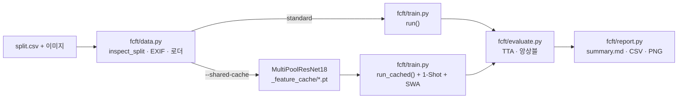

# 아키텍처 개요 (`CNN-FineTuning-FC`)

동결된 `ResNet18` 백본 위에서 **FC 분류 헤드만 빠르고 공정하게 비교**하기 위한 모듈 구조와 데이터 흐름을 정리합니다.

---

## 1. 실행 흐름

1. **데이터 검증 ([`fcft/data.py`](../fcft/data.py))**: `inspect_split()`으로 CSV와 파일 누락을 검사하고, `ImageOps.exif_transpose()`로 EXIF 회전을 보정한 뒤 RGB `(3, 224, 224)`로 변환합니다.
2. **동결 백본 · 다중 풀링 캐시 ([`fcft/data.py`](../fcft/data.py), [`fcft/model.py`](../fcft/model.py))**: `ResNet18` 전체 가중치와 BatchNorm 통계(`eval`)를 고정한 채 `MultiPoolResNet18` 1회 통과로 `avg`·`norm_multiscale`(768D) 등 풀링 특징과 증강 뷰를 `_feature_cache/`에 저장합니다. `test` 세트는 최종 평가 시에만 지연 추출합니다.
3. **정규화 · 헤드 ([`fcft/model.py`](../fcft/model.py))**: `power_l2`, `center_power_l2`, `center_std`, `center_std_power` 정규화와 `linear`, `residual`, `mlp`, `cosine`, `subcenter`, `dual_anchor` 헤드를 조합합니다.
4. **손실 · 학습 ([`fcft/losses.py`](../fcft/losses.py), [`fcft/train.py`](../fcft/train.py))**: `UnifiedClassificationLoss`가 CE·Label Smoothing·Focal·Class Weights·LogitAdj·Mixup/CutMix를 처리하며, `warm_start_ridge` 설정 시 1-Shot 닫힌 해 초기화 후 에폭 학습(`EMA`/`SWA`)을 수행합니다.
5. **평가 · 리포트 ([`fcft/evaluate.py`](../fcft/evaluate.py), [`fcft/report.py`](../fcft/report.py))**: 체크포인트(`best.pt`) 메타데이터를 자동 복원해 `flip2`/`multiview4` TTA 평가와 순위표·곡선 PNG를 생성합니다.

---

## 2. 모듈 맵 및 코어 경계

| 모듈 | 역할 |
| :--- | :--- |
| [`fcft/__init__.py`](../fcft/__init__.py) | 공개 API 단일 진입점 |
| [`fcft/data.py`](../fcft/data.py) | CSV 검증, DataLoader, `MultiPoolResNet18` 디스크 번들 캐시 |
| [`fcft/model.py`](../fcft/model.py) | 동결 백본, 정규화 레이어, 분류 헤드 조립 및 체크포인트 복원 |
| [`fcft/losses.py`](../fcft/losses.py) | `UnifiedClassificationLoss`, Mixup/CutMix, 클래스 불균형 보정 |
| [`fcft/train.py`](../fcft/train.py) | 표준/캐시/`co-train` 학습 루프, train 통계 fit, EMA/SWA 저장 |
| [`fcft/evaluate.py`](../fcft/evaluate.py) · [`report.py`](../fcft/report.py) | Test TTA·앙상블 평가 및 `summary.md`/CSV/PNG 생성 |
| [`fcft/grid.py`](../fcft/grid.py) · [`kfold.py`](../fcft/kfold.py) | Grid 조합 확장, `spawn` 직렬화 팩토리, `test` 격리 K-Fold CV |
| [`fcft/accel.py`](../fcft/accel.py) + `fcft/bin/` | 네이티브 가속(`.so`/`.dll`) 및 암호화 수치 코어(`core.vault`) 인터페이스 |

---

## 3. Linux · Windows 교차 호환 설계

1. **OS 자동 바이너리 로드**: `fcft/accel.py`가 Linux(`.so`)·Windows(`.dll`) 바이너리를 자동 선택합니다.
2. **`spawn` 병렬 안전성**: Optimizer/Scheduler 팩토리를 람다 대신 최상위 클래스(`OptimizerFactory`, `SchedulerFactory`)로 구현해 Windows·Linux 모두에서 `--workers N` 병렬 실행이 가능합니다.
3. **CPU 스레드 경합 제어**: `run_cached()`는 단일 학습 시 스레드를 2 이하로, 병렬 워커 내부에서는 워커당 1스레드로 고정합니다.
